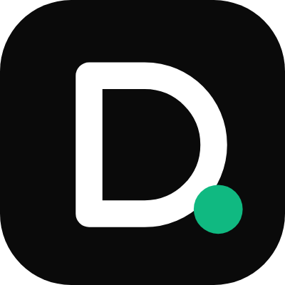

# Deal.ai MCP server

[Deal.ai](https://deal.ai)'s MCP server lets Claude, ChatGPT, Cursor, VS Code and other AI assistants compare every US store's price for the same product, look up its price history, check whether a deal is real, ask Deal.ai's shopping agent what to buy, and watch prices for you. Every answer links to the Deal.ai page it came from.

It's a hosted (remote) server, free with a Deal.ai account. This repository holds no server code: just how to connect, the registry metadata and the client configs.

**Server address (Streamable HTTP):** `https://deal.ai/mcp`

## Connect it

- **Claude:** Deal.ai is in Claude's connectors directory. In Claude, open Settings, then Connectors, choose **Browse connectors** and search for Deal.ai. Or choose **Add custom connector** and paste `https://deal.ai/mcp`.
- **ChatGPT:** turn on developer mode in Settings under Apps, add a new app with `https://deal.ai/mcp` and choose OAuth.
- **Cursor:** use the one-click **Add to Cursor** button on [deal.ai/mcp-server](https://deal.ai/mcp-server#connect), or add [`.mcp.json`](.mcp.json)'s entry to `~/.cursor/mcp.json`.
- **VS Code:** [Install in VS Code](https://vscode.dev/redirect?url=vscode%3Amcp%2Finstall%3F%257B%2522name%2522%253A%2522deal-ai%2522%252C%2522type%2522%253A%2522http%2522%252C%2522url%2522%253A%2522https%253A%252F%252Fdeal.ai%252Fmcp%2522%257D), or add a remote server of type `http` with the address above to `.vscode/mcp.json`.
- **Claude Code:** `claude mcp add --transport http deal-ai https://deal.ai/mcp`
- **Any other client** that supports remote MCP servers over Streamable HTTP with OAuth sign-in.

The first time, the client opens Deal.ai's sign-in in your browser: sign in or create a free account and choose **Allow**. Disconnect an app any time from your [Deal.ai account](https://deal.ai/account).

## Tools

| Tool | What it does |
| --- | --- |
| `search_products` | Searches Deal.ai's product pages, live deals, buying guides and comparisons, with their latest prices. |
| `get_product_prices` | Every store's current price for one product, cheapest first, with a link to buy at each, and its price history. |
| `get_product_details` | A product's description, specs, fact sheet from stores' pages, rating, photos, sizes and best price. |
| `compare_products` | Two to four products side by side: specs, ratings and each one's best price. |
| `get_deals` | Live deals by search, category, store, discount or price, biggest saving first. |
| `check_deal` | Checks a product link from any store, or a product's name, and the price offered: it finds the exact item at every big US store right now. |
| `get_deal_check` | The verdict (cheaper elsewhere, the lowest price, the only store), each store's price with a link, and whether the "was" price holds up. |
| `ask_deal_ai` | Asks Deal.ai's shopping agent, which researches the request and recommends picks with every store's price. Follow-ups continue the same search. |
| `get_deal_ai_answer` | The agent's answer: its picks, why, where each is cheapest, and the search's page on Deal.ai. |
| `watch_price` | Saves a product to your Deal.ai wish list, which e-mails you when its price drops. |
| `list_watched` | The products you're watching, with their price now and when you saved them. |
| `stop_watching` | Removes a product from your wish list. |

## Try asking

- "Ask Deal.ai for the best noise cancelling headphones under $300."
- "Is $199 a good price for AirPods Pro 3? Check it with Deal.ai."
- "What's the lowest price Deal.ai has tracked for the Ninja Creami? Watch it for me."
- "Compare the Sony WH-1000XM6 and Bose QuietComfort Ultra on Deal.ai."
- "What are today's best Best Buy deals on Deal.ai?"

## More

- Docs: https://deal.ai/mcp-server
- Deal checker on the web: https://deal.ai/deal-checker
- Privacy: https://deal.ai/privacy-policy
- Support: support@deal.ai
- Official MCP registry: `ai.deal/deal-ai`

Prices are listed prices at the time shown, before tax. Some store links may earn Deal.ai a commission; that never changes which price is shown first.
